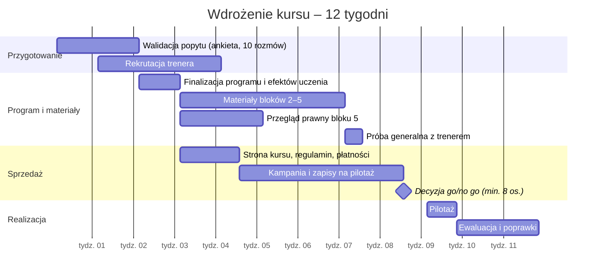

# Harmonogram wdrożenia

Od decyzji o uruchomieniu do pierwszej edycji: **12 tygodni**. Pilotaż w tygodniu 10, wnioski i poprawki w tygodniach 11–12. Daty na wykresie są przykładowe (start: styczeń 2027).

## Kamienie milowe

| Tydzień | Kamień milowy | Kryterium akceptacji |
| --- | --- | --- |
| 2 | Popyt potwierdzony | min. 30 odpowiedzi w ankiecie, 10 rozmów, min. 40% deklaruje zainteresowanie w przedziale 2 000–3 000 zł |
| 4 | Trener zakontraktowany | lekcja próbna oceniona min. 4/5 |
| 7 | Materiały gotowe | prezentacje, notatki trenera, prompty dla 5 bloków; przegląd prawny bloku 5 |
| 8 | Sprzedaż uruchomiona | strona, regulamin, płatności, formularz zapisu |
| 9 | Go/no go | min. 8 opłaconych miejsc 10 dni przed startem |
| 10 | Pilotaż zrealizowany | frekwencja min. 80% |
| 12 | Wersja 1.0 | poprawki po ewaluacji, cennik regularny |

## RACI

| Zadanie | Koordynator | Trener | Marketing | Prawnik / księgowość |
| --- | --- | --- | --- | --- |
| Analiza potrzeb | A/R | C | C | |
| Program i efekty uczenia | A | R | | |
| Materiały | A | R | | C (blok 5) |
| Cennik, budżet | A/R | | C | C |
| Regulamin, umowy | A | | | R |
| Kampania, zapisy | A | C | R | |
| Logistyka edycji | A/R | I | | |
| Prowadzenie zajęć | I | A/R | | |
| Ewaluacja | A/R | C | I | |

R – realizuje, A – odpowiada, C – konsultowany, I – informowany.
